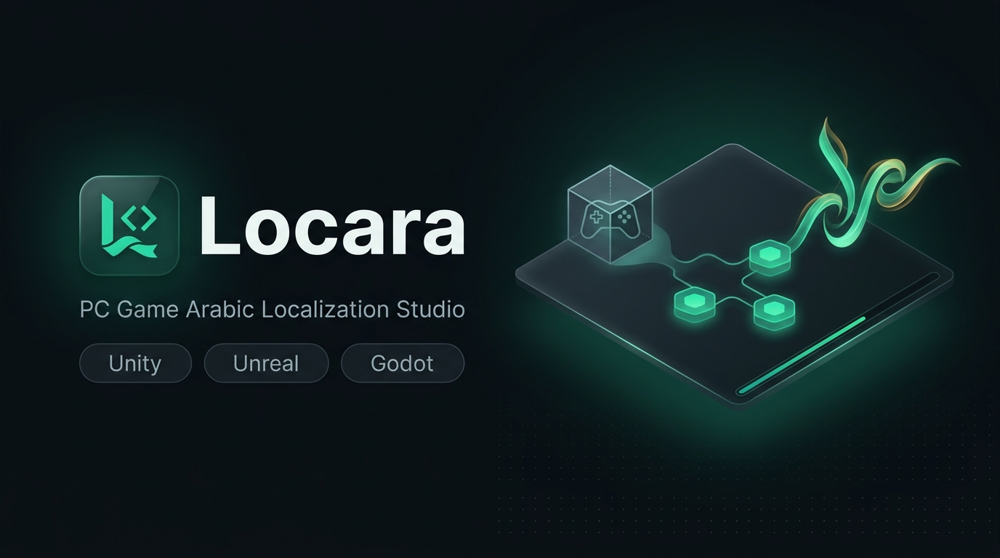

<p align="center">
  
</p>

<div dir="rtl">

# Locara

أداة مجانية ومفتوحة المصدر لتعريب ألعاب الحاسوب على نظام Windows، تعمل بالكامل على جهازك دون أي خوادم خارجية.

تساعدك Locara على استخراج نصوص اللعبة، وترجمتها يدوياً أو باستخدام مفتاح الذكاء الاصطناعي الخاص بك، ثم تجهيز الخط العربي وعرض الحروف المتصلة بشكل سليم، وتجربة التعريب أو تثبيته مع نسخة احتياطية يمكن استعادتها بضغطة زر.

---

## التحميل والتشغيل

1. نزّل ملف `Locara-windows-x64.zip` من صفحة [الإصدارات (Releases)](../../releases/latest).
2. فك الضغط في أي مجلد وشغّل `Locara.Desktop.exe` مباشرة (لا يحتاج تثبيت .NET).

لدليل الاستخدام الكامل راجع [docs/Windows-Release.md](docs/Windows-Release.md).

---

## الألعاب والصيغ المدعومة

- **Unity:** جداول I2 Localization، حزم Addressables (`.bundle`)، النصوص المدمجة في موارد اللعبة، ملفات `XUnity.AutoTranslator` (BepInEx)، والملفات النصية المفتوحة — مع حقن خط عربي تلقائي، وتشكيل الحروف، والتفاف مناسب للأسطر، وملحق `Locara.UnityRtlFix` الاختياري لإصلاح التفاف الأسطر العربية في ألعاب Unity الكلاسيكية (`UI.Text` / `NGUI`)، وخيار تعطيل التشكيل للألعاب التي تدعم العربية أصلاً.
- **Unreal Engine 4 & 5:** ملفات `.locres` وجداول `StringTable` وحزم `.pak` (بما فيها الضغط بـ `Zlib/Gzip/LZ4/Oodle` والحزم المشفّرة بـ AES-256 عند توفر المفتاح)، مع توليد حزمة تعديل جاهزة `*_Locara_P.pak` أو تحديث حزم UE5 IoStore، وحقن خط عربي+لاتيني تلقائي.
- **Godot 3 & 4:** حزم `.pck` (بما فيها Godot 4.5+) وملفات `.translation` الثنائية وملفات النصوص القياسية.
- **GameMaker:** ملفات `data.win` و`game.unx` و`game.ios` (مقطع نصوص `STRG` المُجمَّع) مع تصفية بنيوية للنصوص البشرية فقط، وإعادة بناء آمنة تحافظ على محاذاة `TXTR`/`AUDO`، ونسخ احتياطي موثّق ببصمة SHA-256 عند التثبيت داخل اللعبة. يُكتب العربي افتراضياً بترميز UTF-8 المنطقي، مع خيار اختياري لتفعيل التشكيل المسبق (`gamemaker_shape_arabic`). كما تُدعم ملفات الترجمة الخارجية.
- **محرّكات أخرى:** Ren’Py، وRPG Maker MV/MZ.
- **ملفات النصوص والأرشيفات:** JSON / JSONC، CSV / TSV، XML / XLIFF، INI، YAML، TOML، `.strings`، Lua، `.txt` داخل مجلدات اللغات، PO / POT، XLSX، وأرشيفات ZIP.

> **ملاحظة:** الألعاب التي تستخدم محركاً خاصاً وتخزّن نصوصها داخل حزم ثنائية مخصّصة (مثل `data.pack`) أو داخل الملف التنفيذي مباشرة بدون ملفات لغة مفتوحة لا يمكن استخراج نصوصها تلقائياً.

---

## المزايا الرئيسية

- **واجهة استوديو عربية حديثة (داكن / فاتح):** أربع مراحل واضحة ومنظّمة (المصدر والملفات ← غرفة البوتات ← المحرّر المقسّم ← الخط والتثبيت)، مع تبديل فوري بين المظهر الداكن والفاتح وتجربة استخدام متجاوبة.
- **تصفية تلقائية للملفات:** يميّز ملفات الترجمة الفعلية عن ملفات الإعدادات التقنية واللغات الأخرى، ويتيح لك التحكم بكل ملف ومعاينة نصوصه قبل بدء الترجمة.
- **غرفة البوتات الذكية المترابطة والمحرّر المقسّم:** تعمل 3 بوتات متخصصة (بوت الكشّاف والعالم، بوتات المشاهد المتسلسلة بذاكرة سياق متحركة ومشاركة مصطلحات حية، وبوت المدقق السياقي) عبر Gemini أو Anthropic أو DeepSeek أو Azure أو أي خادم متوافق مع OpenAI باستخدام مفتاحك الخاص (يُحفظ بأمان في Windows Credential Manager)، إلى جانب محرّر مقسّم يعرض سياق المشهد المحيط مع معجم مصطلحات وتصدير/استيراد CSV.
- **حماية رموز اللعبة وجودة الواجهة:** يحافظ تلقائياً على المتغيرات والألوان والوسوم (`{0}`، `%s`، `<color>`، `[tag]`)، ويوفّر **ذاكرة ترجمة مشتركة عابرة للمشاريع** لتعبئة النصوص المتطابقة 100% وتوفير التوكنز، و**فحص اتّساق المعجم** بعد الترجمة، و**تنبيه طول النص** لأزرار وعناوين الواجهة القصيرة.
- **خطوط عربية جاهزة:** يأتي مع خطوط عربية مفتوحة المصدر (Noto Sans Arabic، Noto Naskh Arabic، IBM Plex Sans Arabic، Amiri)، ويمكنك إضافة أي خط `.ttf` أو `.otf` من جهازك.
- **تجربة وتثبيت آمن وتحديثات هادئة:** يمكنك تجربة التعريب مؤقتاً عبر Steam أو تثبيته بشكل دائم مع نسخة احتياطية كاملة وإرجاع الملفات الأصلية بضغطة زر، مع فحص تحديثات اختياري وهادئ عبر GitHub Releases فقط (بدون أي تتبّع وبخيار إيقاف كامل من الإعدادات).
- **معاينة عربية حيّة داخل المحرّر (v1.5.0):** بطاقة في لوحة المحرّر تعرض النص العربي كما سيظهر في اللعبة بعرض صندوق **30 / 45 / 60** حرفاً، بوضعين: **مُشكَّل مسبقاً (PreShaped)** كما تعرضه المحركات التي لا تشكّل الحروف، أو **منطقي (Logical)** للمحركات التي تشكّلها بنفسها، مع تنبيه عند تجاوز عرض الصندوق.
- **بوابة جودة ما قبل البناء (v1.5.0):** بطاقة في صفحة «الحزم» تفحص المشروع في أربع فئات: **أخطاء الرموز والتعارضات** (تمنع البناء)، **مخالفات المعجم اليدوي**، **الأسطر غير المترجمة**، و**تنبيهات الطول** — مع تحذيرات داخل نافذة التأكيد قبل التثبيت المباشر في اللعبة، ومرشّح `length` في المحرّر.
- **تبادل المعجم والتصحيحات الخفيفة (v1.5.0):** تصدير/استيراد المعجم بصيغة JSON أو CSV، وتصدير السطور المعتمدة كملف تصحيح صغير `.locara-patch.json` يمكن مشاركته واستيراده مع معاينة قبل التطبيق. تُحفظ السطور المستوردة افتراضياً بحالة **مستوردة (imported)** للمراجعة، مع خانة اختيارية لاعتمادها مباشرة.
- **تحديث ذاتي موثّق (v1.5.0):** عند توفر إصدار جديد يمكنك تنزيل `Locara-windows-x64.zip` وتثبيته من داخل التطبيق بعد التحقق من بصمة SHA-256 ثم إعادة التشغيل تلقائياً. يبقى رابط صفحة الإصدار على GitHub متاحاً دائماً للتحديث اليدوي.

---

## البناء من المصدر

يتطلب البناء [.NET 10 SDK](global.json) على نظام Windows.

</div>

```powershell
dotnet build -c Release -p:RestoreLockedMode=true
dotnet test -c Release --no-build
powershell -ExecutionPolicy Bypass -File scripts/Publish-Windows.ps1
```

لتشغيل أداة سطر الأوامر:

```powershell
dotnet run --project src/Locara.Cli -- --help
```

<div dir="rtl">

---

## التوثيق والترخيص

- [docs/Windows-Release.md](docs/Windows-Release.md) — دليل الاستخدام على Windows
- [ARCHITECTURE.md](ARCHITECTURE.md) — نظرة تقنية على بنية المشروع للمطوّرين
- [THIRD-PARTY-LICENSES.txt](THIRD-PARTY-LICENSES.txt) — تراخيص المكتبات والخطوط المدمجة

المشروع مرخّص تحت رخصة [MIT](LICENSE).

</div>

---

**English:** Locara is a local-first Windows desktop app and CLI for translating PC games into Arabic. It supports Unity, Unreal Engine 4/5 (including AES-256 encrypted `.pak` files when a key is provided), Godot 3/4, Ren’Py, RPG Maker, GameMaker (external files plus `data.win` / `game.unx` / `game.ios` `STRG` strings), and standard text/archive formats, with built-in Arabic shaping, font injection, bring-your-own-key AI translation, and SHA-256 verified backup/restore. v1.5.0 adds a live in-game Arabic preview, a pre-build QA gate, glossary and light-patch exchange, and a SHA-256 verified in-app self-updater. See [ARCHITECTURE.md](ARCHITECTURE.md) for developer documentation.
